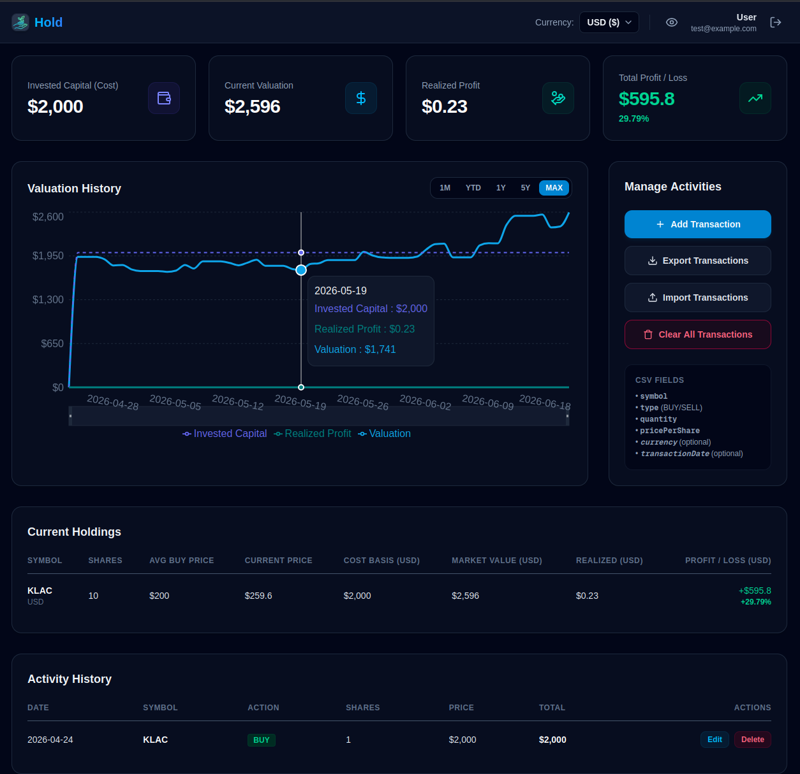
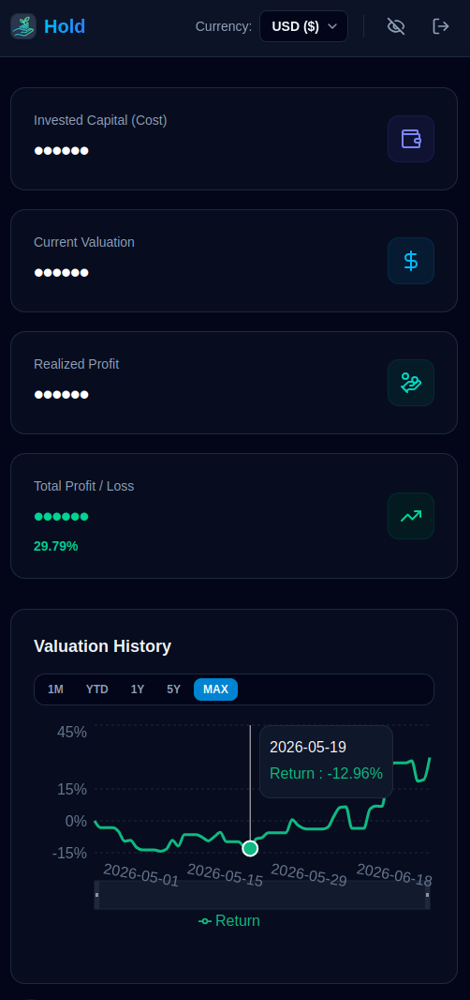
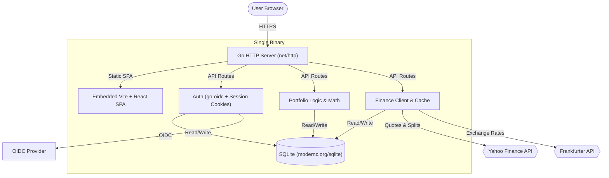

# 📈 Hold - Simple Portfolio Tracker

Hold lets you track your passive investment portfolio as easily as possible - log your BUY orders and let it handle the rest.

> NOTE: This project is developed using AI.

---

## 🌟 Features

- **Simple & Smart**
    - **Multi-currency support** - Convert all transactions to your desired currency on-the-fly.
    - **Stock-splits and dividends calculation** - Adjust holdings and valuation automatically.
    - **Import/export** all of your transactions to/from CSV.
    - **Multi-user support** - OIDC by default, optional demo user for first impression.
    - **Privacy mode** - hide absolute numbers and keep only percentage changes.

- **Visually appealing**
    - **Information boxes** present current status.
    - **Performance chart** shows portfolio progress over time.

---

## 📸 Screenshots

Web app (showcasing a 10:1 split and a 0.23$ dividend):



Mobile + Privacy mode:



---

## 🐳 Trying it out with Docker

Create a hold app on port 3000, with demo login enabled and mounted host directory for the database:

```bash
docker pull gabay/hold

docker run -d \
  -p 3000:3000 \
  -e ALLOW_DEMO_LOGIN=true \
  -e AUTH_URL=http://localhost:3000 \
  -e AUTH_SECRET="replace-this-message-with-64-byte-long-secret-password-right-now" \
  -v /absolute/path/to/db-folder:/app/data \
  gabay/hold:latest
```

> [!IMPORTANT]
> **Database Host Directory Permissions**:
> The container runs as a non-root user (`hold`, UID `1000`). Ensure your host directory `/absolute/path/to/db-folder` is writeable by UID `1000` or has appropriate read/write permissions.

### 🐳 Using Docker Compose

Create a hold app using Docker Compose:

```yaml
services:
  hold:
    container_name: hold
    image: gabay/hold
    ports:
      - 3000:3000
    environment:
      ALLOW_DEMO_LOGIN: "true"
      AUTH_URL: http://localhost:3000
      AUTH_SECRET: "replace-this-message-with-64-byte-long-secret-password-right-now"
      # when ready for production - fill and use these variables:
      # AUTH_OIDC_ISSUER: "https://AUTH_PROVIDER"
      # AUTH_OIDC_CLIENT_ID: "AUTH_PROVIDER_CLIENT_ID"
      # AUTH_OIDC_CLIENT_SECRET: "AUTH_PROVIDER_CLIENT_SECRET"
      # AUTH_OIDC_NAME: "AUTH_PROVIDER_NAME"
    volumes:
      - ./hold/:/app/data/
```

> [!NOTE]
> **Upgrading from older Prisma-based versions**:
> Hold now uses a Go backend with its own SQLite schema (`DATABASE_URL=/app/data/hold.db`). If you are upgrading from an older Next.js/Prisma deployment, export your transactions via **CSV Export** in the old version and import them via **CSV Import** into the new instance.

## 🚀 Running from source

#### Prerequisites

- **Go**: `1.26` or higher
- **Node.js**: `v24.x` (or `v20.x`+) and **pnpm**

#### 1. Install Frontend Dependencies & Build SPA

Clone the repository and build the frontend assets (embedded into the Go binary via `go:embed`):

```bash
pnpm --dir web install
pnpm --dir web build
```

#### 2. Configure Environment Variables

Set environment variables (or export them in your shell):

```env
# Path to SQLite database file (created and migrated automatically on startup)
DATABASE_URL="./data/hold.db"

# Secret key for signing session cookies (Generate with: `openssl rand -base64 32`)
AUTH_SECRET="replace-this-message-with-64-byte-long-secret-password-right-now"

# Public base URL used for OIDC redirects and cookie security
AUTH_URL="http://localhost:3000"

# Enable local demo login (set to "false" in production)
ALLOW_DEMO_LOGIN=true

# (Optional) OpenID Connect (OIDC) provider configuration
# AUTH_OIDC_ISSUER="https://AUTH_PROVIDER"
# AUTH_OIDC_CLIENT_ID="AUTH_PROVIDER_CLIENT_ID"
# AUTH_OIDC_CLIENT_SECRET="AUTH_PROVIDER_CLIENT_SECRET"
# AUTH_OIDC_NAME="AUTH_PROVIDER_NAME"
```

#### 3. Run the Server

Start the Go server (database tables and migrations are applied automatically on startup):

```bash
go run ./cmd/hold
```

Open [http://localhost:3000](http://localhost:3000) in your browser.

#### 4. Frontend Hot-Reload Development Workflow

For frontend development with Vite hot-reload, run the Go backend on port `3000` and the Vite dev server (which proxies `/api/*` requests to `http://localhost:3000`) in a second terminal:

```bash
# Terminal 1: Go API server
ALLOW_DEMO_LOGIN=true go run ./cmd/hold

# Terminal 2: Vite dev server
pnpm --dir web dev
```

---

## 🗃️ CSV Import Format

You can import transaction history in bulk via a CSV file. The CSV file must contain a header row.

| Column            | Required | Description                                                           | Example Values             |
| :---------------- | :------: | :-------------------------------------------------------------------- | :------------------------- |
| `symbol`          | **Yes**  | Stock ticker symbol compatible with Yahoo Finance                     | `AAPL`, `VOO`, `CSPX.L`    |
| `type`            | **Yes**  | Transaction type (case-insensitive)                                   | `BUY`, `SELL`              |
| `quantity`        | **Yes**  | Number of shares transacted (float)                                   | `10`, `2.5`                |
| `pricePerShare`   | **Yes**  | Price per share in the transaction currency (float). _Alias: `price`_ | `175.50`, `94.20`          |
| `currency`        |    No    | Currency of the transaction. Default to ticker symbol                 | `USD`, `EUR`, `GBP`        |
| `transactionDate` |    No    | Date of the transaction. Defaults to today. _Alias: `date`_           | `2023-10-25`, `2024-01-12` |

### Example CSV Content

```csv
symbol,type,quantity,pricePerShare,currency,transactionDate
AAPL,BUY,10,175.50,USD,2026-01-01
VOO,SELL,2,220.00,USD,2026-01-02
CSPX.L,BUY,5,102.30,EUR,2026-01-03
```

---

## 🔐 Configuring OIDC (OpenID Connect)

The application supports standard OIDC providers.
OIDC is configured through the environment variables.

### Example: authentik Identity Setup

1. Create OAuth 2.0 Provider in the authentik admin interface.
2. Set the Authorized Redirect URI to: `http://localhost:3000/api/auth/callback/oidc` (or your hold instance's URL).
3. Configure these variables in `.env`:
    ```env
    AUTH_OIDC_ISSUER="https://AUTHENTIK_DOMAIN"
    AUTH_OIDC_CLIENT_ID="AUTHENTIK_CLIENT_ID"
    AUTH_OIDC_CLIENT_SECRET="AUTHENTIK_CLIENT_SECRET"
    AUTH_OIDC_NAME="authentik"
    ```

---

## 🛠️ Tech Stack

- **Frontend**: React 19, Vite, TypeScript, Tailwind CSS v4, Recharts (Interactive Charts), Lucide React (Icons) — embedded in the Go binary via `go:embed`
- **Backend**: Go `net/http` standard library server
- **Database**: SQLite via `modernc.org/sqlite` (pure Go, zero-CGO)
- **Authentication**: `coreos/go-oidc` + HMAC-signed HTTP-only session cookies (`go-jose`), with optional demo login
- **External APIs**: Yahoo Finance (quotes, splits, dividends, search), Frankfurter API (exchange rates)

---

## 🏗️ Architecture & Data Flow

The following diagram illustrates how the application components interact:



---

## 📁 Project Structure

```
/
├── cmd/
│   └── hold/                # Application entrypoint (main.go)
├── internal/
│   ├── auth/                # OIDC, demo login, & session cookie auth
│   ├── cache/               # TTL cache helpers
│   ├── config/              # Environment variable configuration
│   ├── db/                  # SQLite store, schema, & migrations
│   ├── finance/             # Yahoo Finance & Frankfurter API clients
│   ├── portfolio/           # Portfolio aggregation, splits/dividends, CSV import/export
│   └── server/              # HTTP router, handlers, & SPA fallback
├── web/                     # Vite + React 19 + Tailwind v4 SPA
│   ├── embed.go             # go:embed directive for web/dist
│   ├── public/              # Static assets (favicon, icons)
│   └── src/                 # Frontend components, hooks, & tests
├── scripts/                 # Release & deployment scripts
├── Dockerfile               # Multi-stage Alpine build
├── go.mod                   # Go module dependencies
└── go.sum
```

---

## 🔧 Useful Development Commands

- **Run Go Tests (with race detector)**: `go test -race ./...`
- **Run Go Vet**: `go vet ./...`
- **Build Static Go Binary**: `CGO_ENABLED=0 go build -trimpath -ldflags="-s -w" -o hold ./cmd/hold`
- **Run Frontend Tests**: `pnpm --dir web test`
- **Typecheck Frontend**: `pnpm --dir web exec tsc --noEmit`
- **Build Frontend SPA**: `pnpm --dir web build`

---
